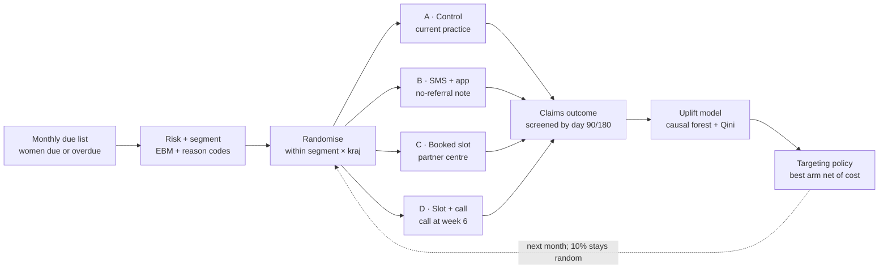

# Rakathon – Od pozvánky k mamografu: research brief

Oct 10, 2026 · @Vít Tuček

## TL;DR

Predict who won't come with a glass-box model, sort them by *why* they don't come, and test cheap, evidence-backed nudges in a randomised trial nested in VZP's own outreach. Target future outreach by measured uplift, not by risk.

- **Label:** no screening mammogram claim (codes 89223 / 89178) within 6 months of the date a woman becomes due. Track diagnostic breast imaging separately, so women screened outside the programme are not counted as non-attenders.
- **Model:** Explainable Boosting Machine (a GAM with pairwise interactions) as the product [\[21\]](https://doi.org/10.1145/2487575.2487579) [\[22\]](https://arxiv.org/abs/1909.09223); LightGBM + SHAP as an accuracy benchmark whose strongest interactions are fed back into the EBM, and TabPFN as a challenger on small tables [\[24\]](https://doi.org/10.1038/s42256-019-0138-9). Screening history will carry most of the signal; the woman's doctors, travel time and centre access add what claims models usually miss [\[17\]](https://www.auntminnie.com/clinical-news/womens-imaging/breast/article/15620951/provider-factors-influence-breast-cancer-screening) [\[18\]](https://jech.bmj.com/content/67/10/861).
- **Segments:** seven barrier-based groups (on-track, recently lapsed, long-lapsed, never-screened but connected to a doctor, never-screened and disconnected, screened outside the programme, access- or health-constrained).
- **Interventions:** SMS/app reminders for women already engaged (+2 to +5 pp in trials [\[30\]](https://pmc.ncbi.nlm.nih.gov/articles/PMC5154292) [\[31\]](https://wrap.warwick.ac.uk/73445/) [\[32\]](https://www.healthday.com/healthpro-news/womens-health/text-message-outreach-can-help-increase-mammogram-completion-rates)); a pre-booked appointment instead of an open invitation for lapsed women (+10 pp in a 26,000-woman NHS trial [\[29\]](https://www.qmul.ac.uk/media/news/2017/smd/clinics-should-choose-womens-breast-screening-appointment-times-to-improve-attendance.html)); lists of overdue women sent to their gynaecologist or GP; phone navigation only where uplift justifies the cost. Skip lotteries and videos: trials show no effect [\[33\]](https://doi.org/10.1001/jamainternmed.2025.5873) [\[34\]](https://scholarworks.brandeis.edu/esploro/outputs/journalArticle/Testing-novel-patient-financial-incentives-to/9924086293001921). No personal cancer-risk messages from claims data; weight targeting by age-specific incidence instead [\[36\]](https://www.bmj.com/content/327/7417/703) [\[37\]](https://doaj.org/article/b1795daf1c81462d9367ba104d78c031).
- **Experiment:** individually randomised, stratified by segment, intention-to-treat, pre-registered, decided with a Bayesian hierarchical model and checked with the frequentist estimate; primary outcome = screening within 90 days, secondary at 180 days. About 3,000–9,000 women per arm detects a 2–3 pp lift.
- **Headline KPIs:** absolute uplift in screening (pp), cost per additional woman screened, change in the deprivation gap, and a capacity guardrail on centre waiting times.

## Czech context

About 4 in 10 eligible Czech women are not screened in a two-year window, and letters alone have barely moved that. Two-year coverage of women 45–69 was 59.9% in 2024, from 73.6% in Třebíč to 45.8% in Cheb [\[6\]](https://www.nzip.cz/data/koncepce2025/k02-p04.pdf). European guidelines aim for at least 70% participation.

**Rules and levers that exist today**

- Women 45+ are entitled to a screening mammogram every two years, with no upper age limit [\[2\]](https://www.vzp.cz/o-nas/aktuality/zeny-od-45-let-budou-mit-jednodussi-cestu-na-mamograficky-screening).
- The usual route is a referral from the GP or gynaecologist at the preventive check-up [\[4\]](https://www.vzp.cz/poskytovatele/informace-pro-praxi/spravny-postup-vykazovani-onkologickeho-screeningu/mamograficky-screeningovy-proces). Since 1 July 2026 a centre may also screen an eligible woman without a referral and check eligibility online. Centres may still insist on a referral, so availability varies by site [\[2\]](https://www.vzp.cz/o-nas/aktuality/zeny-od-45-let-budou-mit-jednodussi-cestu-na-mamograficky-screening).
- VZP's bonus programme for gynaecologists pays 60 CZK per registered client when at least 35% of their registered women 45+ are screened [\[8\]](https://www.vzp.cz/poskytovatele/bonifikace/bonifikacni-program-vzp-plus/gynekologie). A practice-level screening rate therefore already exists inside VZP.
- VZP plans to link centre booking systems to the Moje VZP app so clients can book directly; the app will also alert clients that they are due [\[2\]](https://www.vzp.cz/o-nas/aktuality/zeny-od-45-let-budou-mit-jednodussi-cestu-na-mamograficky-screening) [\[3\]](https://www.vzp.cz/o-nas/aktuality/od-poloviny-roku-na-mamograf-bez-zadanky-vzp-klientkam-zjednodusi-pristup-ke-screeningu).
- VZP pays a 1,000 CZK wellness contribution to clients with any cancer screening in the past two years; 135,000 clients used it last year. 442,000 VZP clients had a screening mammogram that year [\[2\]](https://www.vzp.cz/o-nas/aktuality/zeny-od-45-let-budou-mit-jednodussi-cestu-na-mamograficky-screening).
- Screening is billed as 89223 (every two years) or 89178 (yearly, for high-risk women in dispensary care). Follow-up is billed as 89225 extra views, 89510 ultrasound and 89314 biopsy, within 6 months of the screen [\[4\]](https://www.vzp.cz/poskytovatele/informace-pro-praxi/spravny-postup-vykazovani-onkologickeho-screeningu/mamograficky-screeningovy-proces). These codes define the outcome label and the recall features.
- The Ministry of Health publishes the list of accredited screening centres, last updated 13 January 2026 [\[9\]](https://mzd.gov.cz/souhrnny-seznam-poskytovatelu-kteri-splnili-podminky-pro-udeleni-statusu-screeningoveho-pracoviste-pro-mamarni-screening/). It is the starting point for the travel-time features.

**What earlier outreach achieved**

- Insurers have mailed personalised invitations to non-attenders since January 2014. For VZP, monthly screening mammograms rose only from 31,001 to 32,548 (+5%), against +26% for colorectal screening [\[5\]](https://www.vzp.cz/o-nas/aktuality/rok-a-pul-zvala-vzp-na-vysetreni-dopisem-vysledek-pres-3-miliony-prohlidek). That comparison was before–after with no control group, so the true effect is unknown.
- In a 2023 survey of 71 centres, 36 sent no invitations of their own; the rest used SMS, letters or both. Inviting centres saw about 10 pp higher return for the next round (75.4% vs 65.3% in 2022), though this is observational [\[7\]](https://preview-mamo.iba.muni.cz/res/file/datovy-audit-prezentace/2023/12-ambrozova-veverkova.pdf).
- VZP names fear of the result, unwillingness, not knowing the entitlement and not knowing how to get there as the main barriers. The chair of the national screening commission expects the new measures to add 5–8 pp [\[2\]](https://www.vzp.cz/o-nas/aktuality/zeny-od-45-let-budou-mit-jednodussi-cestu-na-mamograficky-screening).

**The event:** Rakathon runs 16–18 October 2026 in Prague, Brno and Ostrava. Teams get 24 hours after the Friday brief, local juries judge on Saturday and the national final is on Sunday [\[1\]](https://www.vzp.cz/o-nas/aktuality/vzp-se-stava-hlavnim-partnerem-rakathonu-soutezicim-otevre-tri-realne-vyzvy-ceskeho-zdravotnictvi). The brief explicitly asks for a way to verify that an intervention raised attendance.

## What predicts non-attendance

Past behaviour predicts best; the woman's doctors, social disadvantage, chronic and mental illness and poor access come next. Almost all of it has a proxy in insurer claims data. Odds ratios below are unadjusted and come mostly from a 66-study meta-analysis of population programmes [\[10\]](https://pmc.ncbi.nlm.nih.gov/articles/PMC8634222/).

| Factor | Evidence (OR of attending unless stated) | Proxy in VZP data |
| --- | --- | --- |
| Screening history | Previous attender OR 3.32; first invitation OR 0.22 [\[10\]](https://pmc.ncbi.nlm.nih.gov/articles/PMC8634222/) | Number of past screens, months since last, on-time share, ever screened |
| Bad last experience | False-positive recall OR 0.77 for re-attending [\[10\]](https://pmc.ncbi.nlm.nih.gov/articles/PMC8634222/) | Extra views, ultrasound or biopsy (89225, 89510, 89314) within 6 months of the last screen [\[4\]](https://www.vzp.cz/poskytovatele/informace-pro-praxi/spravny-postup-vykazovani-onkologickeho-screeningu/mamograficky-screeningovy-proces) |
| Primary care contact | 60+ primary care visits OR 2.70 [\[10\]](https://pmc.ncbi.nlm.nih.gov/articles/PMC8634222/); no GP or dental contact lowers use [\[13\]](https://medicaljournalssweden.se/actaoncologica/article/view/28475) | Registered GP and gynaecologist, last preventive check-up, cervical and colorectal screening |
| Doctor and practice | After patient adjustment, 41% of between-provider variation sat with individual providers, 35% with health systems, 24% with practices [\[17\]](https://www.auntminnie.com/clinical-news/womens-imaging/breast/article/15620951/provider-factors-influence-breast-cancer-screening) | Practice's past screening rate and referral conversion (next section) |
| Socioeconomic position | Medium vs low SES OR 1.45; homeowner OR 2.16; married OR 1.86 [\[10\]](https://pmc.ncbi.nlm.nih.gov/articles/PMC8634222/) | Area deprivation by municipality, insurance category (employee, self-employed, state-insured) |
| Migration and language | Non-immigrant OR 2.23; non-English speaker OR 0.33–0.43 [\[10\]](https://pmc.ncbi.nlm.nih.gov/articles/PMC8634222/) | Foreign insurance history, correspondence language (use only to add support) |
| Chronic and mental illness | Severe multimorbidity: prevalence ratio 1.53 for non-participation [\[11\]](https://pmc.ncbi.nlm.nih.gov/articles/PMC4623919); schizophrenia OR 0.58; disability benefits OR 0.70 [\[10\]](https://pmc.ncbi.nlm.nih.gov/articles/PMC8634222/) | Chronic diagnosis count, psychiatric care, disability-related claims |
| Access | No car OR 0.33–0.43; rural vs urban no difference [\[10\]](https://pmc.ncbi.nlm.nih.gov/articles/PMC8634222/); 6.3 pp lower at 50–75 km, 9.8 pp beyond 75 km [\[18\]](https://jech.bmj.com/content/67/10/861) | Travel time to nearest and usual centre; centre access measures (next section) |
| Age | No consistent difference between 50–59 and 60–69 [\[10\]](https://pmc.ncbi.nlm.nih.gov/articles/PMC8634222/) | Age band; also sets the value of an extra screen, since incidence rises with age |
| Screening outside the programme | 51.5% of German non-attenders said they had breast checks elsewhere [\[15\]](https://pmc.ncbi.nlm.nih.gov/articles/PMC9818884/) | Diagnostic mammography (89180) and breast ultrasound claims |

Three findings shape the design:

- **Non-attenders are not one group.** Intermittent attenders differ socially from never-attenders [\[14\]](https://calls.ac.uk/?p=2267); Danish registry data split active cancellers from passive no-shows [\[12\]](https://pmc.ncbi.nlm.nih.gov/articles/PMC3526420).
- **Some reasons yield, some don't.** In the German trial, phone counselling worked for missed letters, bad dates and time pressure, but not for women who felt healthy, avoided doctors or were screened elsewhere [\[15\]](https://pmc.ncbi.nlm.nih.gov/articles/PMC9818884/).
- **Missing the first invitation casts a long shadow.** In Stockholm, 32.1% skipped their first invitation and stayed less likely to attend later rounds; BMJ has since attached an expression of concern to the paper's mortality messaging [\[16\]](https://bmjgroup.com/missing-first-screening-appointment-linked-to-higher-risk-of-breast-cancer-death).

## Recommended model

Ship an Explainable Boosting Machine trained on due-episodes, validated forward in time, and judged on calibration and lift at outreach capacity rather than AUC alone. Use a gradient-boosting benchmark to find the interactions the glass box should carry.

**Unit and label**

- One row per woman per due-episode. Index date = 24 months after her last screening mammogram, her 45th birthday, or her VZP entry, whichever applies.
- Label = 1 if no 89223 or 89178 claim within 6 months of the index date [\[4\]](https://www.vzp.cz/poskytovatele/informace-pro-praxi/spravny-postup-vykazovani-onkologickeho-screeningu/mamograficky-screeningovy-proces); 12 months as a sensitivity check.
- Exclude prior breast cancer and women in high-risk surveillance; censor deaths and departures from VZP.
- Flag diagnostic mammography (89180) or breast ultrasound in the prior 24 months as screened-elsewhere. Model it as its own outcome, not as non-attendance.

**Features:** only what is known on the index date, from the proxies in the table above. Add the doctor, geography and centre-access families described in the next section. Add contactability (mobile number on file, Moje VZP user) and past invitation letters with responses, because they decide which interventions are even deliverable.

**Models**

1. Baseline: logistic regression with splines on age and months since last screen. This is the bar to beat.
2. Product: EBM, a GAM with pairwise interactions [\[21\]](https://doi.org/10.1145/2487575.2487579), from InterpretML [\[22\]](https://arxiv.org/abs/1909.09223). Each feature has an exact, plottable shape function, so the global explanation is the model itself.
3. Benchmark: LightGBM with SHAP [\[23\]](https://arxiv.org/abs/1705.07874). If the EBM is within about 0.01 AUROC, ship the EBM and report the gap.

**TabPFN as a challenger on small tables**

TabPFN is a transformer pre-trained on millions of synthetic datasets; it predicts in one forward pass, with no tuning [\[42\]](https://doi.org/10.1038/s41586-024-08328-6). TabPFN-2.5 handles up to 50,000 rows and 2,000 features and outperformed tuned tree models on the TabArena benchmark [\[43\]](https://arxiv.org/abs/2511.08667).

- **Not for the full table.** VZP's episode table will hold millions of rows. Scaling Mode lifts the row limit, but its authors see no sign of the gap to gradient boosting shrinking at that scale, and access is by waitlist [\[44\]](https://priorlabs.ai/technical-reports/large-data-model). LightGBM stays the full-data benchmark.
- **Where it fits.** Tables of hundreds to tens of thousands of rows: segment-specific models (e.g. never-screened, disconnected women in one kraj), practice- or centre-level tables, and the first trial readout, where outcomes come from a few thousand women per arm. It is also a quick check on a stratified 50,000-row sample: if it beats LightGBM on the same sample, LightGBM is under-tuned.
- **Constraints.** The weights are licensed for non-commercial research and internal evaluation; production use needs a commercial licence [\[43\]](https://arxiv.org/abs/2511.08667). Run it locally (`pip install tabpfn`) on a GPU. Do not use the cloud client (`tabpfn-client`) with health claims, because it processes data on Prior Labs' servers.
- **Explainability.** It needs post-hoc SHAP, like LightGBM. Its distillation engine compresses it into an MLP or tree ensemble [\[43\]](https://arxiv.org/abs/2511.08667), but neither is a glass box. Treat it as a benchmark, not the shipped model.

**Distil the benchmark into the glass box**

Shapley tools add little accuracy to the boosted model itself, which already finds interactions. Their value is in moving what it learned into the EBM, pruning redundant features and catching drift.

1. Compute TreeSHAP interaction values on the validation year (a sample of about 10,000 rows is enough) and rank feature pairs by mean absolute interaction [\[24\]](https://doi.org/10.1038/s42256-019-0138-9).
2. Pass the top 5–10 pairs to the EBM as forced interactions and compare with its own interaction search. If the gap to LightGBM closes, the jury gets black-box accuracy in a glass box.
3. Rank features by SAGE, a Shapley decomposition of the loss rather than of the prediction [\[25\]](https://arxiv.org/abs/2004.00668). Mean absolute SHAP shows what the model relies on; SAGE shows what buys accuracy. Drop near-zero groups only if validation log-loss does not worsen.
4. Group correlated clusters (GP visits, gynaecologist visits, cervical screening) by absolute Spearman correlation and attribute to groups with Owen values (`shap.PartitionExplainer`). Interventional SHAP credits what the model uses but leaves the data manifold; conditional SHAP stays on it but credits proxies [\[26\]](https://arxiv.org/abs/1903.10464). Variance-based Shapley effects handle dependent inputs in principle but are costly [\[27\]](https://doi.org/10.1137/130936233) [\[28\]](https://doi.org/10.1137/15M1048070).
5. Run loss-based TreeSHAP on the 2025 test year. Features whose loss contribution flips sign between years point to drift or leakage.
6. Use SHAP dependence plots to suggest engineered features, such as thresholds at 24 or 36 months since the last screen. These help the EBM more than the GBM.

Do all selection inside the training folds; selecting on the test year makes the reported accuracy optimistic.

**Validation**

- Temporal split: train on episodes indexed 2022–2023, tune on 2024, test on 2025. Treat 2020–2021 as COVID-distorted.
- Hold out two kraje to test transfer across regions, e.g. one high- and one low-coverage area.
- Recalibrate once post-July-2026 episodes exist: dropping the referral requirement shifts the base rate.
- Published survey-based models reached AUROC 0.79 in Spain [\[19\]](https://frontiersin.org/journals/public-health/articles/10.3389/fpubh.2023.1332277/text) and 0.87 in Korea [\[20\]](https://arxiv.org/abs/2101.11614). Treat a claims model far above that as a leakage alarm until checked.

**What the jury sees**

- Global shape plots for the top drivers, with the interaction terms that matter.
- Three to five reason codes per woman, mapped to barriers ("lapsed after a recall", "no gynaecologist visit in 3 years"). These assign her segment.
- One plain caveat: these are risk markers, not proven causes. Causal claims come only from the trial.

## Doctors, geography, centre access and cancer risk

Add three feature families that claims-only models usually miss: the woman's doctors, her distance to a centre, and how hard that centre is to use. Each also points to an intervention. Use cancer risk to weight targeting, not to message women.

**Gynaecologists and GPs**

- **Evidence.** After adjusting for patient mix, 41% of between-provider variation in screening rates sat with individual providers, 35% with health systems and 24% with practices [\[17\]](https://www.auntminnie.com/clinical-news/womens-imaging/breast/article/15620951/provider-factors-influence-breast-cancer-screening). In Czechia the referral normally comes from the preventive check-up [\[4\]](https://www.vzp.cz/poskytovatele/informace-pro-praxi/spravny-postup-vykazovani-onkologickeho-screeningu/mamograficky-screeningovy-proces), and VZP's bonus already uses each gynaecologist's share of registered women 45+ screened [\[8\]](https://www.vzp.cz/poskytovatele/bonifikace/bonifikacni-program-vzp-plus/gynekologie). A letter signed by the woman's own doctor did not help in the Penn trial (12.5% vs 11.4%, not significant) [\[32\]](https://www.healthday.com/healthpro-news/womens-health/text-message-outreach-can-help-increase-mammogram-completion-rates): what matters is what the doctor does.
- **Features.** Registered gynaecologist and GP, or none; months since the last preventive check-up; the practice's past screening rate among women 45+; referral conversion, i.e. the share of check-ups followed by a screen within 6 months.
- **Leakage and noise.** Compute practice rates from earlier years and leave the woman out. Shrink them toward the regional mean (empirical Bayes), so a practice with 30 women isn't judged on noise.
- **Variance split.** Next to the EBM, fit a multilevel logistic model with random intercepts for the gynaecologist's and GP's practice. Report the share of variation in non-attendance that sits between practices. A Bayesian version on practice-year counts gives the same shrinkage with credible intervals (see Experiment design).
- **Caveat.** Health-conscious women tend to pick conscientious doctors, so practice effects are not purely causal.
- **Trial arm.** A monthly list of overdue registered women sent to each practice, randomised by practice. Keep practice rates internal; no published league tables.

**Geography**

- **Evidence.** In Quebec (833,856 women), participation was 6.3 pp lower at 50–75 km and 9.8 pp lower beyond 75 km than under 2.5 km. The drop began around 12.5 km in small cities, 25 km in suburbs and 50 km in rural areas. Participation was lowest on Montreal Island, where everyone lives within 12.5 km [\[18\]](https://jech.bmj.com/content/67/10/861). No access to a car shows OR 0.33–0.43 [\[10\]](https://pmc.ncbi.nlm.nih.gov/articles/PMC8634222/). Expect thresholds in the far tail, not a steady slope; in cities the barriers are something else.
- **Features.** Car and public-transport travel time to the nearest accredited centre and to her previous centre; centres within 30 minutes; a bypass flag when she used a farther centre than the nearest, which hints at a problem with the nearest one.
- **Build this week.** Take the centre list from the Ministry of Health [\[9\]](https://mzd.gov.cz/souhrnny-seznam-poskytovatelu-kteri-splnili-podminky-pro-udeleni-statusu-screeningoveho-pracoviste-pro-mamarni-screening/) and compute a municipality × centre travel-time matrix with OSRM on OpenStreetMap. With about 6,250 municipalities the matrix is small. Keep held-out kraje in validation, because geography tracks deprivation.

**Appointment access and punctuality**

Claims don't record booking or waiting times, but proxies exist now and direct measures can be piloted.

| Measure | How | At the hackathon? |
| --- | --- | --- |
| Referral-to-exam lag | Days from the preventive check-up to the screening claim, per centre | Yes, if visit codes are in the data |
| Centre load | Screens per working day, year-end peaks | Yes |
| Recall rate | Extra views, ultrasound or biopsy (89225, 89510, 89314) within 6 months of a screen [\[4\]](https://www.vzp.cz/poskytovatele/informace-pro-praxi/spravny-postup-vykazovani-onkologickeho-screeningu/mamograficky-screeningovy-proces). False positives cut re-attendance (OR 0.77) [\[10\]](https://pmc.ncbi.nlm.nih.gov/articles/PMC8634222/) | Yes |
| Next-round return per centre | Share screened again 24–30 months later | Yes |
| Time to third next available slot | Standard access metric; the third slot is used because the first two often come from cancellations [\[41\]](https://cincinnatichildrens.org/about/quality-measures/system-level-measures/3rd-next-available-appointment). Mystery-shopper calls now, Moje VZP booking logs later | Pilot |
| Waiting on the day | Booked time vs the acquisition time stamped on each mammogram image (DICOM) | Pilot with a few centres |
| Experience | A 2–3 question SMS after the visit (wait, pain, would recommend), linked to next-round return | Pilot |

Attach centre features to each woman through her usual or nearest centre. Use them as moderators in the trial, for example whether pre-booking helps less where waits are long, and to choose partner centres for the pre-booked arm. Two cautions: a busy centre may be busy because it is good, and the lag mixes the woman's own delay with the centre's.

**Cancer risk: weight the targeting, don't tell the woman**

- **Risk feedback does raise attendance.** A Cochrane review of 13 trials, 10 on mammography, found a pooled OR of 1.5 (95% CI 1.11–2.03), but could not say whether choices were well informed [\[36\]](https://www.bmj.com/content/327/7417/703). In the PROCAS cohort (26,668 women), women told they were at higher risk returned more often in the next round (89.2% vs 78.8%); women told below average attended the first round slightly less (85.6% vs 86.4%) [\[37\]](https://doaj.org/article/b1795daf1c81462d9367ba104d78c031).
- **Claims can't support a real risk score.** Risk models need genes, family history, breast density and reproductive history, as in the WISDOM trial [\[38\]](https://www.nih.gov/news-events/nih-research-matters/testing-risk-based-breast-cancer-screening). Claims hold none of these, and never-screened women have no density reading. A claims-only score would be mostly age, plus a past biopsy (89314), high-risk eligibility (89178) and hormone replacement therapy prescriptions. A "you're low risk" message from the insurer, built on that, would be false reassurance.
- **What is worth it for VZP.** An extra screen is worth more where cancer is more likely, and that rises with age. Rank women by predicted uplift × age-specific incidence from the national cancer registry, i.e. expected cancers found per 1,000 contacts. This raises value per crown spent, not uplift itself.
- **Spin-off arm.** Route women with claims markers of higher risk to their doctor for a proper risk assessment and, where eligible, annual high-risk screening [\[4\]](https://www.vzp.cz/poskytovatele/informace-pro-praxi/spravny-postup-vykazovani-onkologickeho-screeningu/mamograficky-screeningovy-proces).

## Segments

Segment by barrier, then rank by risk inside each segment. Risk says who is unlikely to come; the barrier says what might change that. The highest-risk women are often the least persuadable: a reminder letter did not raise 180-day attendance among older previous non-attenders [\[30\]](https://pmc.ncbi.nlm.nih.gov/articles/PMC5154292), and phone counselling did not move women who felt healthy or avoided doctors [\[15\]](https://pmc.ncbi.nlm.nih.gov/articles/PMC9818884/).

| # | Segment | Rule on the index date | Likely barrier | First-line offer |
| --- | --- | --- | --- | --- |
| 1 | On-track | Screened in each of the last two rounds | Forgetting, timing | App push + SMS with booking link [\[31\]](https://wrap.warwick.ac.uk/73445/) [\[32\]](https://www.healthday.com/healthpro-news/womens-health/text-message-outreach-can-help-increase-mammogram-completion-rates) |
| 2 | Recently lapsed | Screened before; 24–48 months since last | Inertia, scheduling | Pre-booked appointment at usual centre + SMS [\[29\]](https://www.qmul.ac.uk/media/news/2017/smd/clinics-should-choose-womens-breast-screening-appointment-times-to-improve-attendance.html) |
| 3 | Long-lapsed | Last screen over 4 years ago, or lapsed after a recall | Bad experience, fear | Pre-booked appointment + phone call addressing the recall [\[10\]](https://pmc.ncbi.nlm.nih.gov/articles/PMC8634222/) [\[15\]](https://pmc.ncbi.nlm.nih.gov/articles/PMC9818884/) |
| 4 | Never screened, connected | No screen ever; gynaecologist or GP visit in 2 years | No prompt; unaware no referral is needed | Overdue list to the registering doctor + letter on direct access [\[2\]](https://www.vzp.cz/o-nas/aktuality/zeny-od-45-let-budou-mit-jednodussi-cestu-na-mamograficky-screening) |
| 5 | Never screened, disconnected | No screen ever; no gynaecologist, few contacts | Low engagement, distrust | Phone navigation; test before scaling [\[35\]](https://ssph-journal.org/journals/public-health-reviews/articles/10.3389/phrs.2025.1607873/text) |
| 6 | Screened elsewhere | Diagnostic mammogram or breast ultrasound in 2 years | None, or quality | Exclude from non-attender counts; light quality message [\[15\]](https://pmc.ncbi.nlm.nih.gov/articles/PMC9818884/) |
| 7 | Access or health constrained | Long travel time, disability or severe multimorbidity | Logistics, competing illness | Flexible slots, navigator, link with treating doctor [\[11\]](https://pmc.ncbi.nlm.nih.gov/articles/PMC4623919) [\[18\]](https://jech.bmj.com/content/67/10/861) |

Rules come first in a fixed order (6 → 7 → 1–5) so each woman lands in exactly one segment. First job with the data: size each segment and its baseline 6-month attendance; those two numbers set sample sizes and expected impact. Within each segment, practice and centre features from the previous section decide whether the doctor route or the centre route is tried first.

Check the rules against the data: cluster the EBM's local contributions and see whether data-driven groups line up with the seven. Keep the rules for operations, because call-centre staff and doctors can apply them.

## Interventions that work

Changing the default to a booked slot moves lapsed women most (about +10 pp); cheap reminders add 2–5 pp among women who already intend to go; human contact fixes logistics but not attitudes; money and videos do almost nothing. A meta-analysis of 44 RCTs found a pooled OR of 1.55 overall and 1.81 in underserved groups, where reminders, phone contact and navigation did best [\[35\]](https://ssph-journal.org/journals/public-health-reviews/articles/10.3389/phrs.2025.1607873/text).

| Intervention | Best trial | Effect (absolute) | Cost | Segments |
| --- | --- | --- | --- | --- |
| Pre-booked appointment instead of open invitation, for non-attenders | RCT, 6 NHS centres, \~26,000 women [\[29\]](https://www.qmul.ac.uk/media/news/2017/smd/clinics-should-choose-womens-breast-screening-appointment-times-to-improve-attendance.html) | 22.3% vs 12.3% within 90 days; +7 to +14 pp by site; larger in low-SES areas | Low per letter; needs slots and some overbooking | 2, 3 |
| SMS 48 h before a booked appointment | RCT, 2,240 first invitations, London [\[31\]](https://wrap.warwick.ac.uk/73445/) | 59.1% → 64.4% ITT, though only 41% had a number; advance cancellations up about 3× | Very low | 1, 2 |
| Text messages after outreach | Two RCTs, 24,632 women, Penn [\[32\]](https://www.healthday.com/healthpro-news/womens-health/text-message-outreach-can-help-increase-mammogram-completion-rates) | +2.1 and +2.5 pp at 3 months | Very low | 1, 2, 4 |
| Postal reminder a few days before | RCT, 22,828 women, NW England [\[30\]](https://pmc.ncbi.nlm.nih.gov/articles/PMC5154292) | +4.0 pp at 30 days, +2.7 pp at 180 days; none at 180 days for older previous non-attenders | Low | 1 |
| Removing the order step | Penn trial A [\[32\]](https://www.healthday.com/healthpro-news/womens-health/text-message-outreach-can-help-increase-mammogram-completion-rates) | 12.7% → 15.4% at 3 months | Process change | All: the Czech analogue is the July 2026 rule [\[2\]](https://www.vzp.cz/o-nas/aktuality/zeny-od-45-let-budou-mit-jednodussi-cestu-na-mamograficky-screening); test telling women about it |
| Letter signed by own clinician | Penn trial B [\[32\]](https://www.healthday.com/healthpro-news/womens-health/text-message-outreach-can-help-increase-mammogram-completion-rates) | 11.4% vs 12.5%, not significant | Very low | 4, as a secondary factor only |
| Overdue lists to the registering doctor | No trial found; practice variation is large [\[17\]](https://www.auntminnie.com/clinical-news/womens-imaging/breast/article/15620951/provider-factors-influence-breast-cancer-screening) and VZP already pays on practice rates [\[8\]](https://www.vzp.cz/poskytovatele/bonifikace/bonifikacni-program-vzp-plus/gynekologie) | Unknown; test it, randomised by practice | Low | 4 |
| Barrier-specific phone counselling | RCT, rural Germany [\[15\]](https://pmc.ncbi.nlm.nih.gov/articles/PMC9818884/) | 45.9% vs 28.6%, but among women reached by phone, not ITT | High: 15–20 minute calls | 3, 5, 7, targeted by uplift |
| Dedicated scheduling hotline | RCT, 9,000 overdue women, Singapore [\[33\]](https://doi.org/10.1001/jamainternmed.2025.5873) | 13.8% vs 11.2%, not significant after multiplicity; $212 per extra mammogram | Medium | 3, 5 |
| Personal cancer-risk feedback | Cochrane review of 13 RCTs [\[36\]](https://www.bmj.com/content/327/7417/703); PROCAS cohort [\[37\]](https://doaj.org/article/b1795daf1c81462d9367ba104d78c031) | Pooled OR 1.5; next-round return 89.2% vs 78.8% for high-risk feedback; slight dip for low-risk | Needs real risk data | None from claims; see the previous section |
| Small cash incentive or lottery | RCT, 4,427 women, Tufts [\[34\]](https://scholarworks.brandeis.edu/esploro/outputs/journalArticle/Testing-novel-patient-financial-incentives-to/9924086293001921); Singapore arms [\[33\]](https://doi.org/10.1001/jamainternmed.2025.5873) | No significant effect; lottery cost $3,209 per extra mammogram | Medium | None as a main lever |
| Motivational video | Singapore arm [\[33\]](https://doi.org/10.1001/jamainternmed.2025.5873) | −0.4 pp | Medium | None |

Two cautions for Czech delivery. App pushes alone are weak: in Singapore only 4.1% of pushes were clicked [\[33\]](https://doi.org/10.1001/jamainternmed.2025.5873), so pair Moje VZP alerts with SMS. And a pre-booked slot needs partner centres that hold slots, which fits VZP's planned booking link-up [\[3\]](https://www.vzp.cz/o-nas/aktuality/od-poloviny-roku-na-mamograf-bez-zadanky-vzp-klientkam-zjednodusi-pristup-ke-screeningu).

VZP's existing 1,000 CZK benefit [\[2\]](https://www.vzp.cz/o-nas/aktuality/zeny-od-45-let-budou-mit-jednodussi-cestu-na-mamograficky-screening) is a cheap test: mention it or not in the reminder. Expect a small effect at best, given the incentive trials [\[33\]](https://doi.org/10.1001/jamainternmed.2025.5873) [\[34\]](https://scholarworks.brandeis.edu/esploro/outputs/journalArticle/Testing-novel-patient-financial-incentives-to/9924086293001921).

## Experiment design

Run a stratified, individually randomised multi-arm trial inside VZP's monthly outreach, analysed intention-to-treat on claims and pre-registered before the first message goes out.

*Every outreach month doubles as a randomised test.*

Each month's outreach is the experiment: arms are randomised within segments and scored on claims, then the uplift model picks arms for the next cohort while 10% stay random.

**Who and how**

- Population: VZP women due or overdue in a given month, excluding segment 6 and anyone with breast cancer history.
- Randomise individuals by a seeded hash of the pseudonymised ID, stratified by segment × kraj.
- Keep a current-practice control arm in every segment. It costs nothing extra and is the only way to know the counterfactual, which the 2014 letter programme never had [\[5\]](https://www.vzp.cz/o-nas/aktuality/rok-a-pul-zvala-vzp-na-vysetreni-dopisem-vysledek-pres-3-miliony-prohlidek).
- Example arms for segments 2–3: A current practice · B SMS + Moje VZP alert saying no referral is needed, with a booking link [\[2\]](https://www.vzp.cz/o-nas/aktuality/zeny-od-45-let-budou-mit-jednodussi-cestu-na-mamograficky-screening) [\[32\]](https://www.healthday.com/healthpro-news/womens-health/text-message-outreach-can-help-increase-mammogram-completion-rates) · C pre-booked slot at a partner centre + SMS [\[29\]](https://www.qmul.ac.uk/media/news/2017/smd/clinics-should-choose-womens-breast-screening-appointment-times-to-improve-attendance.html) · D = C plus a call to non-responders at 6 weeks [\[15\]](https://pmc.ncbi.nlm.nih.gov/articles/PMC9818884/).
- Doctor arm for segment 4: overdue lists sent to the registering gynaecologist or GP. It acts through the practice, so randomise practices, not women.
- Primary outcome: screening claim (89223 or 89178) within 90 days of first contact [\[4\]](https://www.vzp.cz/poskytovatele/informace-pro-praxi/spravny-postup-vykazovani-onkologickeho-screeningu/mamograficky-screeningovy-proces). Secondary: 180 days (more screens, or only earlier ones?), any breast imaging, and return at the next round.
- Record centre access measures (lag, load, third next available slot) as moderators, so the analysis can show where pre-booking works and where capacity blocks it.

**Sample size per arm** (two-sided α = 0.05, 80% power; normal approximation)

| Baseline 90-day uptake | Detect +2 pp | Detect +3 pp | Detect +5 pp |
| --- | --- | --- | --- |
| 10% | 3,841 | 1,774 | 686 |
| 20% | 6,510 | 2,943 | 1,094 |
| 30% | 8,394 | 3,763 | 1,377 |
| 50% | 9,806 | 4,356 | 1,565 |

Three arms against one control with a Bonferroni α of 0.0167 needs about a third more: 8,683 per arm for +2 pp from 20%. The practice-randomised arm multiplies by the design effect 1 + (m − 1) × ICC; with 50 women per practice and an assumed ICC of 0.02 that is about 2×. VZP insures over 6 million people [\[1\]](https://www.vzp.cz/o-nas/aktuality/vzp-se-stava-hlavnim-partnerem-rakathonu-soutezicim-otevre-tri-realne-vyzvy-ceskeho-zdravotnictvi), so these numbers fit in one or two monthly cohorts.

**Analysis**

- ITT difference in proportions with 95% CI, adjusted for the model's predicted risk. The score is measured before treatment, so it cuts variance without biasing the estimate.
- Effects by segment are pre-specified. Heterogeneity beyond that is exploratory: causal forest [\[39\]](https://doi.org/10.1080/01621459.2017.1319839) or X-learner [\[40\]](https://doi.org/10.1073/pnas.1804597116) fitted on one half, judged by Qini curves on the other.
- Write the decision rule in advance, e.g. scale an arm if its lower 95% bound exceeds +1 pp and its cost per extra screen is below a threshold VZP sets.
- No peeking: one fixed analysis date, or a group-sequential plan with spending rules.

**Bayesian analysis: yes, as the decision layer**

A Bayesian hierarchical model suits this trial: many segment × arm cells, monthly cohorts, and a decision that turns on costs. Keep the frequentist ITT estimate beside it as a check; with weak priors and these sample sizes the two will agree.

- **Model.** Logistic regression of 90-day screening on arm × segment, with segment-level arm effects drawn from a common distribution, plus kraj and practice intercepts. Partial pooling stabilises small segments and replaces a pile of separate subgroup tests.
- **Outputs.** The posterior of the absolute lift (pp) per arm and segment, of extra screens per 1,000 contacted, and of cost per extra screen. These answer VZP's question directly: how likely is it that this arm is worth scaling?
- **Decision rule, pre-registered.** For example, scale an arm in a segment if P(lift > 1 pp) > 0.95 and P(cost per extra screen < threshold) > 0.8. VZP sets the threshold; the probabilities here are suggestions.
- **Priors.** Weakly informative and centred on no effect for the primary analysis, so the evidence comes from VZP's own data. Literature-informed priors (2–5 pp for reminders, about 10 pp for pre-booked slots) go in a sensitivity analysis only.
- **Operating characteristics.** Simulate the design to report its false-positive rate and power under the chosen priors and thresholds. FDA's January 2026 draft guidance covers Bayesian methods for primary inference [\[47\]](https://www.fda.gov/regulatory-information/search-fda-guidance-documents/use-bayesian-methodology-clinical-trials-drug-and-biological-products); Berry gives the general case for Bayesian trials [\[45\]](https://doi.org/10.1038/nrd1927).
- **Adaptation, carefully.** Monthly cohorts invite updating: each posterior becomes the next month's prior, and Bayesian interim looks can drop clearly futile arms. Avoid response-adaptive randomisation in the evaluation phase: the 90-day outcome lag, seasonal and policy drift (the July 2026 referral change), and known bias and efficiency problems argue for fixed allocation with a protected control share [\[46\]](https://doi.org/10.1093/annonc/mdv238). Thompson-style allocation belongs in the targeting phase, where the 10% random holdout keeps it honest.
- **Practice and centre effects** can use the same machinery: a Bayesian model on practice-year counts (small, fast) gives shrunken practice rates with credible intervals for the features in the previous section.
- **Demo.** Simulate a trial and show each segment's posterior lift tightening month by month, with the decision rule drawn on it. It makes "how will we know it worked" visible in one picture.

Tools: PyMC or bambi in Python, brms in R.

**From trial to targeting**

- Wave two assigns each woman the arm with the highest predicted uplift net of cost, weighted by age-specific breast cancer incidence. The policy then maximises expected cancers found per crown, not just screens. Keep a 10% random holdout so the policy itself stays testable.
- If individual randomisation is blocked, fall back to a stepped-wedge rollout by kraj and month. It is weaker but still controlled.

## KPIs

The headline is the absolute increase in women screened per 1,000 contacted, with its cost; every other KPI either explains it or guards against a side effect. Targets below are suggested starting points for VZP to confirm.

| Layer | KPI | Definition | Suggested target or rule |
| --- | --- | --- | --- |
| Intervention | 90-day uptake lift | Arm minus control, share with an 89223/89178 claim within 90 days of first contact, ITT | Pre-registered minimum: +2 to +3 pp; Bayesian rule P(lift > 1 pp) > 0.95 |
| Intervention | 180-day uptake lift | Same at 180 days | Lift persists, i.e. not just earlier visits [\[30\]](https://pmc.ncbi.nlm.nih.gov/articles/PMC5154292) |
| Intervention | Extra screens per 1,000 contacted | 1,000 × absolute lift; NNT = 1 / lift | Reported per arm and segment |
| Intervention | Cost per additional woman screened | Incremental arm cost ÷ extra screens | Below a CZK threshold VZP sets |
| Intervention | Next-round return | Screened again 24–30 months later | Not lower than control |
| Targeting | Expected cancers found per 1,000 contacts | Extra screens weighted by age-specific incidence | Higher than risk-only or random targeting |
| Targeting | Qini coefficient | Uplift-ranked targeting vs random, on held-out trial data [\[39\]](https://doi.org/10.1080/01621459.2017.1319839) | Positive, with CI above zero |
| Equity | Deprivation gap | Uptake difference, most vs least deprived quintile (or state-insured vs employed) | Gap narrows in treated arms |
| Doctors | Between-practice variation | Share of variation at practice level; spread of shrunken practice rates [\[17\]](https://www.auntminnie.com/clinical-news/womens-imaging/breast/article/15620951/provider-factors-influence-breast-cancer-screening) | Narrows where the doctor arm runs |
| Operations | Booked-slot use | Share of pre-booked slots attended, cancelled ahead, or missed | No-shows below control's open-invitation level |
| Operations | Time to third next available slot | Days to the third open screening slot at partner centres [\[41\]](https://cincinnatichildrens.org/about/quality-measures/system-level-measures/3rd-next-available-appointment) | No increase beyond an agreed limit |
| Operations | Waiting on the day | Minutes from booked time to image acquisition, pilot centres | Tracked; agreed ceiling |
| Operations | Reachability | Share with a mobile number on file or active Moje VZP | Tracked; sets the ceiling for SMS arms |
| Operations | Opt-outs and complaints | Per 1,000 contacted | Below an agreed ceiling |
| Model | Discrimination | AUROC and PR-AUC on the 2025 test set | Above the logistic baseline; leakage check if far above 0.87 [\[20\]](https://arxiv.org/abs/2101.11614) |
| Model | Calibration | Slope and intercept; reliability plot | Slope 0.9–1.1 |
| Model | Lift at capacity | Non-attenders captured in the top k by risk, k = outreach budget | Several-fold over random |
| Model | Glass-box gap | AUROC of LightGBM minus EBM with distilled interactions | About 0.01 or less [\[24\]](https://doi.org/10.1038/s42256-019-0138-9) |
| Model | Subgroup stability | AUROC and calibration by age band, kraj, insurance category | Gaps flagged, not hidden |
| Long term | Cancer detection and stage | Cancers per 1,000 screens; share stage 0–I among women invited | Monitored with the national registry |

Keep the 90- and 180-day versions side by side. In the NHS reminder trial, older previous non-attenders showed a non-significant rise at 30 days and none by 180 days: at most, the reminder changed timing, not attendance [\[30\]](https://pmc.ncbi.nlm.nih.gov/articles/PMC5154292).

## 24-hour plan for four

Build everything except the real data before Friday, so the 24 hours go into fitting, checking and the story.

**This week, before the brief**

- [ ] Code the pipeline against a synthetic claims table: episode builder, labels, EBM, LightGBM, TabPFN on a 50,000-row sample (local GPU), calibration plots.
- [ ] Code the distillation step: TreeSHAP interaction ranking → forced EBM interactions, SAGE ranking, grouped Owen values [\[24\]](https://doi.org/10.1038/s42256-019-0138-9) [\[25\]](https://arxiv.org/abs/2004.00668).
- [ ] Precompute the municipality × centre travel-time matrix from the Ministry of Health centre list with OSRM [\[9\]](https://mzd.gov.cz/souhrnny-seznam-poskytovatelu-kteri-splnili-podminky-pro-udeleni-statusu-screeningoveho-pracoviste-pro-mamarni-screening/).
- [ ] Write the shrunken practice-rate function (empirical Bayes, leave-one-out, earlier years only) and the multilevel model.
- [ ] Simulate a trial with literature effect sizes by segment, and build the ITT readout, the Bayesian hierarchical readout with the decision rule, and the Qini evaluation on it.
- [ ] Power-calculation notebook or small widget, mirroring the table above.
- [ ] Draft Czech SMS, Moje VZP push and letter texts per segment: plain, non-coercive, stating benefits and harms.
- [ ] One-page pre-registration template: population, arms, outcome, horizon, decision rule.
- [ ] Questions for VZP mentors on Friday: registered GP and gynaecologist IDs, preventive check-up codes, centre ID on each claim, municipality of residence, which years and codes are included, and whether a live pilot is possible.

**During the event**

| Role | Owns | Ready by |
| --- | --- | --- |
| Data lead | Episode table, labels, features (incl. practice, travel time, centre measures), leakage and COVID checks | Hour 6 |
| Modeller | Baseline, EBM, LightGBM benchmark, distillation, calibration, subgroup checks, reason codes | Hour 12 |
| Segments and interventions | Segment rules, sizes, baseline uptake, practice variance split, intervention matrix, message drafts | Hour 14 |
| Experiment and pitch | Power, pre-registration, KPI board, simulated readout (labelled as simulated), deck | Hour 22 |

Tools: `interpret` (EBM), `lightgbm`, `shap`, `scikit-learn`, `statsmodels` (multilevel models), OSRM for travel times, tabpfn (local only), PyMC or bambi for the Bayesian models, and `causalml` or `econml` for uplift and Qini.

**Demo story:** three women from the data. Show each one's risk and reason codes, her doctor and nearest centre, her segment, the offer she gets, and how the trial will tell whether it worked.

## Pitfalls, ethics and data protection

The likeliest ways to fool yourselves are leakage and calling predictors causes; the likeliest way to harm women is pushing demand into centres with no free slots.

- **Leakage.** Drop anything dated after the index date: the visit that issued the referral, recall imaging, the screening claim itself. Practice and centre rates must come from earlier periods and leave the woman out.
- **False non-attenders.** Diagnostic imaging after symptoms and self-paid screening look like non-attendance [\[15\]](https://pmc.ncbi.nlm.nih.gov/articles/PMC9818884/). Flag the first; name the second as a limit of claims data.
- **Shifting base rates.** COVID distorted 2020–2021; the July 2026 referral change and Moje VZP alerts change behaviour now [\[2\]](https://www.vzp.cz/o-nas/aktuality/zeny-od-45-let-budou-mit-jednodussi-cestu-na-mamograficky-screening). Recalibrate, and let the control arm absorb the drift.
- **Prediction is not cause.** "No gynaecologist visit" marks risk. Whether alerting her gynaecologist helps is a question only the trial answers. The same holds for practice rates (women choose their doctors) and centre load (busy centres may be good ones).
- **Shapley values describe the model, not the world.** Correlated features split credit arbitrarily unless grouped [\[26\]](https://arxiv.org/abs/1903.10464); do feature selection inside training folds.
- **Risk-only targeting wastes effort** on women who will never respond and on those who would come anyway. Move to uplift targeting once trial data exist [\[39\]](https://doi.org/10.1080/01621459.2017.1319839).
- **Fairness.** Use social markers to add support, never to withhold it. No ethnicity or migration-status features; report model performance by subgroup.
- **No false reassurance.** Do not send claims-based "low risk" messages; below-average risk feedback slightly lowered attendance even with real risk data [\[37\]](https://doaj.org/article/b1795daf1c81462d9367ba104d78c031).
- **Doctors.** Use practice rates for support and outreach, not public rankings. Small practices need shrinkage before any comparison.
- **Informed choice.** Messages state benefits and harms, including false positives and overdiagnosis, in a non-coercive tone. A French decision-aid RCT (DECIDEO, listed in [\[10\]](https://pmc.ncbi.nlm.nih.gov/articles/PMC8634222/)) lowered attendance; agree with VZP that the goal is informed uptake.
- **Capacity.** Agree held slots with partner centres before any pre-booking arm, and stop an arm if the third-next-available slot moves past the agreed limit [\[41\]](https://cincinnatichildrens.org/about/quality-measures/system-level-measures/3rd-next-available-appointment).
- **Data protection.** Work on pseudonymised data at the event. Before a live pilot, run a data protection impact assessment and confirm the legal basis and opt-out route with VZP's data protection officer.
- **Multiplicity.** Arms × segments multiply comparisons. Pre-specify the primary contrasts and adjust for the rest.

## Literature

Numbers in square brackets throughout the report point here; each one also links straight to the source. Summaries are marked where the original paper was not opened directly.

**Czech programme and VZP data**

1. VZP. [VZP se stává hlavním partnerem Rakathonu. Soutěžícím otevře tři reálné výzvy českého zdravotnictví](https://www.vzp.cz/o-nas/aktuality/vzp-se-stava-hlavnim-partnerem-rakathonu-soutezicim-otevre-tri-realne-vyzvy-ceskeho-zdravotnictvi). Press release, 8 Oct 2026.
2. VZP. [Ženy od 45 let budou mít jednodušší cestu na mamografický screening](https://www.vzp.cz/o-nas/aktuality/zeny-od-45-let-budou-mit-jednodussi-cestu-na-mamograficky-screening). Press release with Q&A, 24 Jun 2026.
3. VZP. [Od poloviny roku na mamograf bez žádanky](https://www.vzp.cz/o-nas/aktuality/od-poloviny-roku-na-mamograf-bez-zadanky-vzp-klientkam-zjednodusi-pristup-ke-screeningu). Press release, 18 May 2026.
4. VZP. [Mamografický screeningový proces](https://www.vzp.cz/poskytovatele/informace-pro-praxi/spravny-postup-vykazovani-onkologickeho-screeningu/mamograficky-screeningovy-proces). Referral pathway and billing codes 89223, 89178, 89225, 89510, 89314, 89180.
5. VZP. [Rok a půl zvala VZP na vyšetření dopisem](https://www.vzp.cz/o-nas/aktuality/rok-a-pul-zvala-vzp-na-vysetreni-dopisem-vysledek-pres-3-miliony-prohlidek). Results of personalised invitations 2014–2015, 24 Aug 2015.
6. ÚZIS / NZIP. [Pokrytí cílové populace mamografickým screeningem 2023–2024](https://www.nzip.cz/data/koncepce2025/k02-p04.pdf). Coverage by district.
7. Ambrožová M, Veverková L. [Výsledky dotazníkového šetření: zvaní žen screeningovými centry](https://preview-mamo.iba.muni.cz/res/file/datovy-audit-prezentace/2023/12-ambrozova-veverkova.pdf). IBA MU data audit, 2023.
8. VZP. [Bonifikační program VZP PLUS: gynekologie](https://www.vzp.cz/poskytovatele/bonifikace/bonifikacni-program-vzp-plus/gynekologie). Bonus tied to the share of registered women 45+ screened.
9. Ministry of Health CZ. [Souhrnný seznam poskytovatelů se statusem screeningového pracoviště pro mamární screening](https://mzd.gov.cz/souhrnny-seznam-poskytovatelu-kteri-splnili-podminky-pro-udeleni-statusu-screeningoveho-pracoviste-pro-mamarni-screening/). Accredited centres, updated 13 Jan 2026.

**Who does not attend, and why**

10. Mottram R, et al. [Factors associated with attendance at screening for breast cancer: a systematic review and meta-analysis](https://pmc.ncbi.nlm.nih.gov/articles/PMC8634222/). BMJ Open 2021;11:e046660.
11. Jensen LF, Pedersen AF, Andersen B, et al. [Non-participation in breast cancer screening for women with chronic diseases and multimorbidity: a population-based cohort study](https://pmc.ncbi.nlm.nih.gov/articles/PMC4623919). BMC Cancer 2015;15:798. doi:10.1186/s12885-015-1829-1.
12. Jensen LF, Pedersen AF, Andersen B, et al. [Identifying specific non-attending groups in breast cancer screening: population-based registry study of participation and socio-demography](https://pmc.ncbi.nlm.nih.gov/articles/PMC3526420). BMC Cancer 2012;12:518. doi:10.1186/1471-2407-12-518.
13. Kristiansen M, et al. [Participation in mammography screening among migrants and non-migrants in Denmark](https://medicaljournalssweden.se/actaoncologica/article/view/28475). Acta Oncol 2012;51:28–36.
14. Coyle C, Kinnear H, Rosato M, Mairs A, Hall C, O'Reilly D. [Do women who intermittently attend breast screening differ from those who attend every invitation and those who never attend?](https://calls.ac.uk/?p=2267) J Med Screen 2014;21(2):98–103. doi:10.1177/0969141314533677.
15. Fochler S, et al. [Reasons for non-attendance in the German national mammography screening program: telephone counseling RCT](https://pmc.ncbi.nlm.nih.gov/articles/PMC9818884/). Healthcare 2023;11:17.
16. Ma Z, et al. First mammography screening participation and breast cancer incidence and mortality in the subsequent 25 years. BMJ 2025;390:e085029. [BMJ press release](https://bmjgroup.com/missing-first-screening-appointment-linked-to-higher-risk-of-breast-cancer-death); an expression of concern is attached.
17. Onega T, et al. Provider and health-system variation in breast cancer screening. J Gen Intern Med 2018. [AuntMinnie summary](https://www.auntminnie.com/clinical-news/womens-imaging/breast/article/15620951/provider-factors-influence-breast-cancer-screening).
18. St-Jacques S, et al. [Geographic access to mammography screening centre and participation of women in the Quebec Breast Cancer Screening Programme](https://jech.bmj.com/content/67/10/861). J Epidemiol Community Health 2013;67:861–7.

**Prediction and explainability**

19. Pedrós Barnils N, Schüz B. [Intersectional analysis of inequalities in self-reported breast cancer screening attendance using supervised machine learning](https://frontiersin.org/journals/public-health/articles/10.3389/fpubh.2023.1332277/text). Front Public Health 2024;11.
20. [Predicting participation in cancer screening programs with machine learning](https://arxiv.org/abs/2101.11614). arXiv 2101.11614, 2021.
21. Lou Y, Caruana R, Gehrke J, Hooker G. [Accurate intelligible models with pairwise interactions](https://doi.org/10.1145/2487575.2487579). KDD 2013:623–631.
22. Nori H, et al. [InterpretML: a unified framework for machine learning interpretability](https://arxiv.org/abs/1909.09223). arXiv 1909.09223, 2019.
23. Lundberg SM, Lee SI. [A unified approach to interpreting model predictions](https://arxiv.org/abs/1705.07874). NeurIPS 2017.
24. Lundberg SM, Erion G, Chen H, et al. [From local explanations to global understanding with explainable AI for trees](https://doi.org/10.1038/s42256-019-0138-9). Nat Mach Intell 2020;2:56–67.
25. Covert I, Lundberg S, Lee SI. [Understanding global feature contributions with additive importance measures (SAGE)](https://arxiv.org/abs/2004.00668). NeurIPS 2020.
26. Aas K, Jullum M, Løland A. [Explaining individual predictions when features are dependent](https://arxiv.org/abs/1903.10464). Artif Intell 2021.
27. Owen AB. [Sobol' indices and Shapley value](https://doi.org/10.1137/130936233). SIAM/ASA J Uncertain Quantif 2014;2:245–251.
28. Song E, Nelson BL, Staum J. [Shapley effects for global sensitivity analysis: theory and computation](https://doi.org/10.1137/15M1048070). SIAM/ASA J Uncertain Quantif 2016;4:1060–1083.

**Interventions**

29. Allgood PC, Maroni R, Hudson S, et al. [Effect of second timed appointments for non-attenders of breast cancer screening in England: a randomised controlled trial](https://doi.org/10.1016/S1470-2045%2817%2930340-6). Lancet Oncol 2017;18(7):972–980. Results as reported in the [QMUL summary](https://www.qmul.ac.uk/media/news/2017/smd/clinics-should-choose-womens-breast-screening-appointment-times-to-improve-attendance.html).
30. Allgood PC, Maxwell AJ, Hudson S, et al. [A randomised trial of the effect of postal reminders on attendance for breast screening](https://pmc.ncbi.nlm.nih.gov/articles/PMC5154292). Br J Cancer 2016;114:171–176.
31. Kerrison RS, et al. [Text-message reminders increase uptake of routine breast screening appointments: an RCT in a hard-to-reach population](https://wrap.warwick.ac.uk/73445/). Br J Cancer 2015;112:1005–1010.
32. Mehta SJ, et al. Behavioral interventions to improve breast cancer screening outreach: two randomized clinical trials. JAMA Intern Med 2024;184:761–768. [HealthDay summary](https://www.healthday.com/healthpro-news/womens-health/text-message-outreach-can-help-increase-mammogram-completion-rates).
33. Lee SC, Lucky SS, Zhu J, et al. [Pragmatic interventions to boost surveillance mammogram uptake among an overdue population: a randomized clinical trial](https://doi.org/10.1001/jamainternmed.2025.5873). JAMA Intern Med 2026;186:27–35.
34. Merrick EL, et al. [Testing novel patient financial incentives to increase breast cancer screening](https://scholarworks.brandeis.edu/esploro/outputs/journalArticle/Testing-novel-patient-financial-incentives-to/9924086293001921). Am J Manag Care 2015;21:771–779.
35. Ferrari A, et al. [Advancing mammographic screening among underserved groups: a systematic review and meta-analysis of intervention strategies](https://ssph-journal.org/journals/public-health-reviews/articles/10.3389/phrs.2025.1607873/text). Public Health Rev 2025;46.

**Cancer risk information**

36. Edwards A, et al. [Effects of communicating individual risks in screening programmes: Cochrane systematic review](https://www.bmj.com/content/327/7417/703). BMJ 2003;327:703.
37. French DP, McWilliams L, Howell A, Evans DG. [Does receiving high or low breast cancer risk estimates produce a reduction in subsequent breast cancer screening attendance? Cohort study](https://doaj.org/article/b1795daf1c81462d9367ba104d78c031). Breast 2022;64:47–49. PROCAS cohort, Manchester.
38. WISDOM investigators. Risk-based vs annual breast cancer screening: the WISDOM randomized clinical trial. JAMA 2025. [NIH summary](https://www.nih.gov/news-events/nih-research-matters/testing-risk-based-breast-cancer-screening).

**Experiment, targeting and access metrics**

39. Wager S, Athey S. [Estimation and inference of heterogeneous treatment effects using random forests](https://doi.org/10.1080/01621459.2017.1319839). J Am Stat Assoc 2018;113:1228–1242.
40. Künzel SR, Sekhon JS, Bickel PJ, Yu B. [Metalearners for estimating heterogeneous treatment effects using machine learning](https://doi.org/10.1073/pnas.1804597116). PNAS 2019;116:4156–4165.
41. Cincinnati Children's. [3rd next available appointment](https://cincinnatichildrens.org/about/quality-measures/system-level-measures/3rd-next-available-appointment). Definition of the standard appointment-access metric.

**Tabular foundation models**

42. Hollmann N, Müller S, Purucker L, et al. [Accurate predictions on small data with a tabular foundation model](https://doi.org/10.1038/s41586-024-08328-6). Nature 2025.
43. Prior Labs. [TabPFN-2.5: advancing the state of the art in tabular foundation models](https://arxiv.org/abs/2511.08667). arXiv 2511.08667, 2025. Licence terms on the [model card](https://huggingface.co/Prior-Labs/tabpfn_2_5).
44. Prior Labs. [Introducing Scaling Mode for TabPFN](https://priorlabs.ai/technical-reports/large-data-model). Technical report, 1 Dec 2025.

**Bayesian analysis and adaptive designs**

45. Berry DA. [Bayesian clinical trials](https://doi.org/10.1038/nrd1927). Nat Rev Drug Discov 2006;5:27–36.
46. Thall P, Fox P, Wathen J. [Statistical controversies in clinical research: scientific and ethical problems with adaptive randomization in comparative clinical trials](https://doi.org/10.1093/annonc/mdv238). Ann Oncol 2015;26:1621–1628.
47. US FDA. [Use of Bayesian methodology in clinical trials of drug and biological products](https://www.fda.gov/regulatory-information/search-fda-guidance-documents/use-bayesian-methodology-clinical-trials-drug-and-biological-products). Draft guidance, January 2026.

Sample sizes in the experiment section were computed for this report (normal approximation for two proportions).
