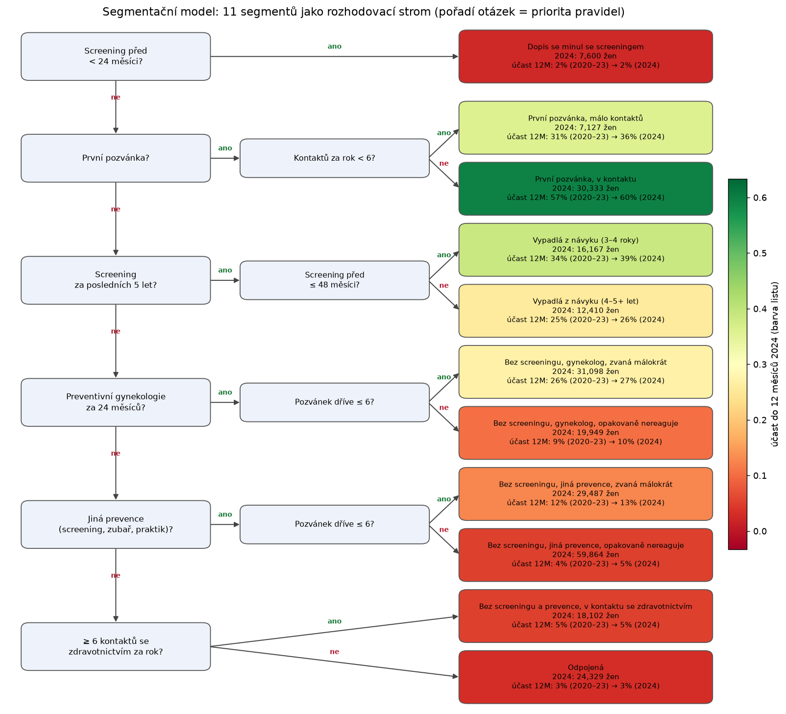
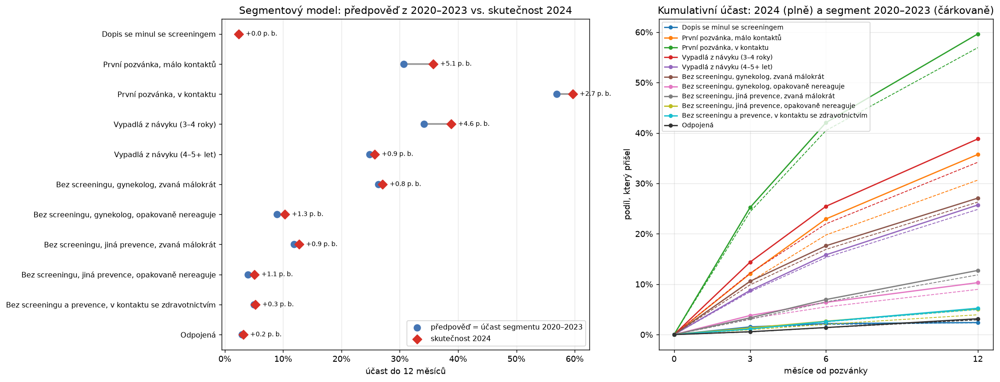
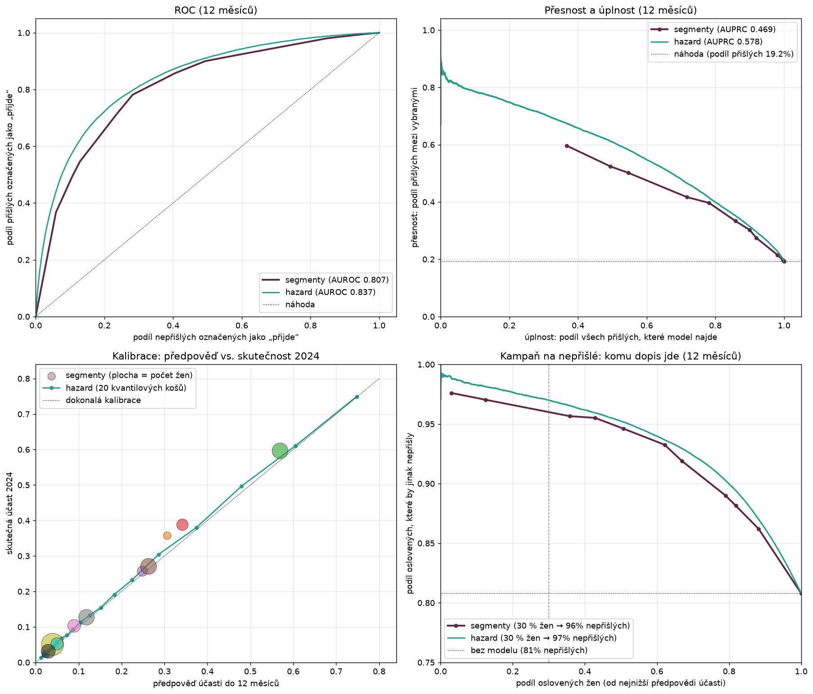
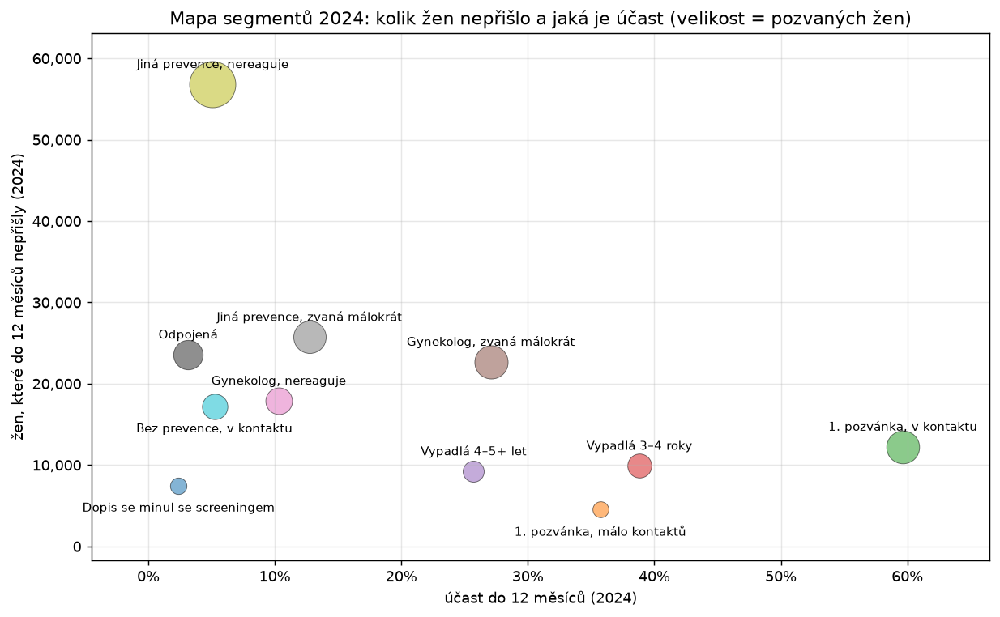
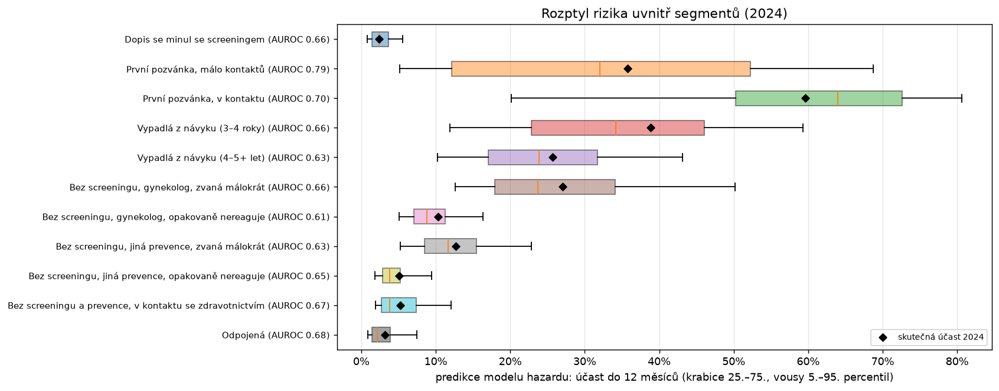
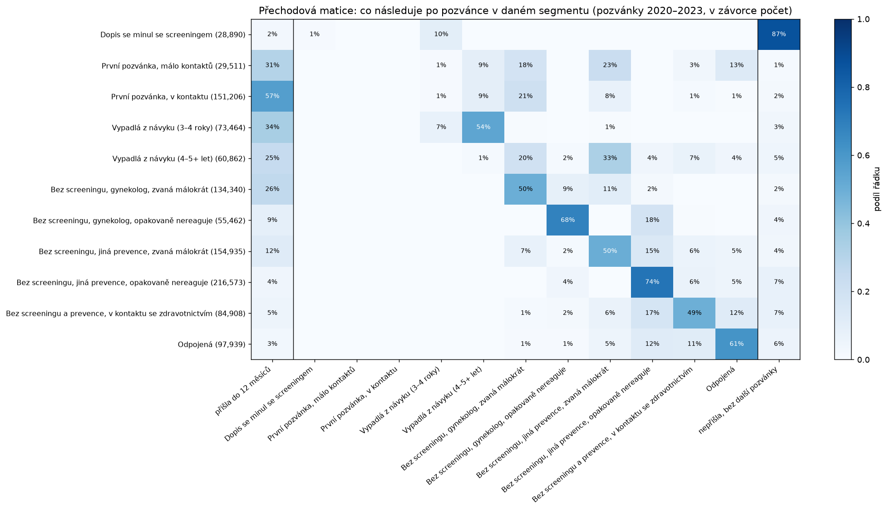
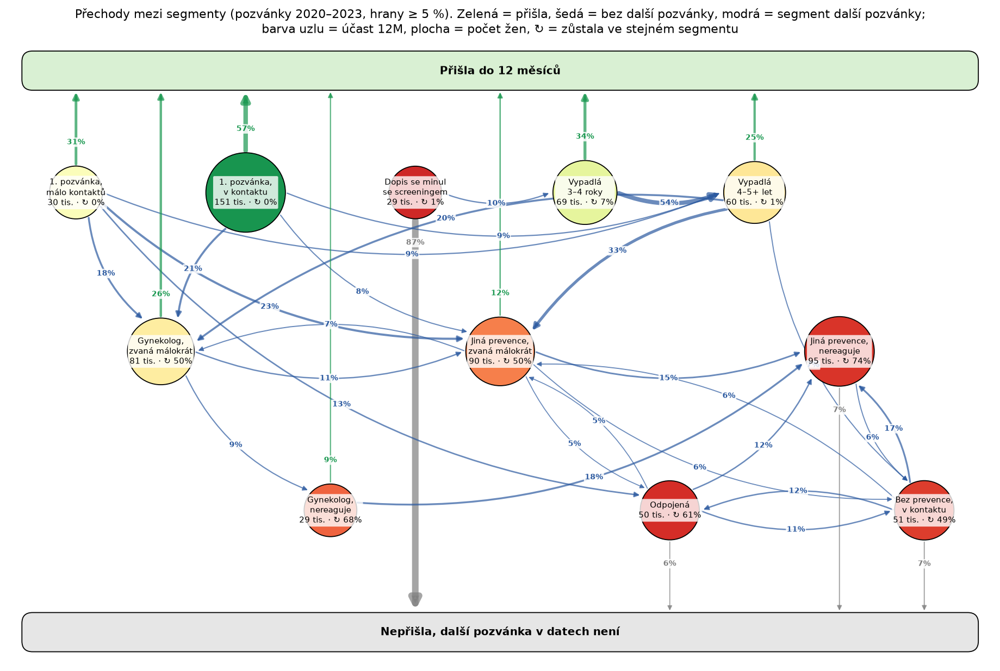
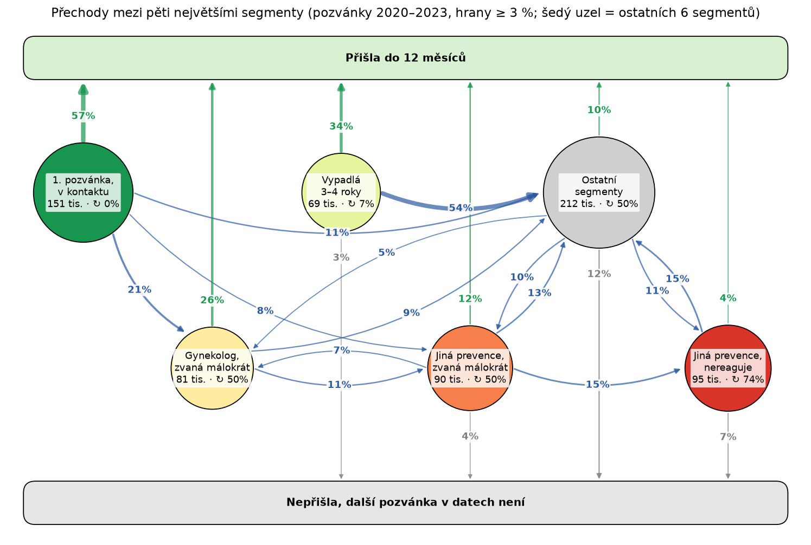

# Od pozvánky k mamografu: segmenty pozvaných žen

**Data VZP 2020–2024 · 1 344 556 pozvánek · 508 527 žen**

Segmentační model s 11 pravidly, jeho ověření na roce 2024, přechody mezi segmenty a návrhy experimentů.

Zdroj: `notebooks/vzp_segmentation_final.ipynb`

---

## Otázka a data

- **Kdo po adresné pozvánce přijde na mamograf a kdo ne?** Kde jsou ženy, které nechodí, a jak je oslovit?
- Pozvánky VZP 2020–2024 pro ženy nepřetržitě pojištěné 2015–2025. Účast = mamografie do 3, 6 a 12 měsíců po pozvánce.
- **Segmentační model:** 11 srozumitelných pravidel nad sloupci VZP. Pozvánka patří do prvního segmentu, jehož pravidlo platí.
- **Poctivé ověření:** model „naučený“ na letech 2020–2023 (účast segmentu) a otestovaný na roce 2024 (256 466 žen).

---

## Segmentační model: 11 segmentů jako rozhodovací strom

Tři rozměry: **historie screeningu**, **kontakt se zdravotnictvím a prevencí**, **počet nevyslyšených pozvánek**. Účast mezi listy se liší 25× (2–60 %).

---

## Model z let 2020–2023 platí i v roce 2024

| 2024, do 12 měsíců | AUROC | log-loss |
|---|---|---|
| 11 segmentů (účast 2020–2023) | **0,807** | 0,387 |
| plný model hazardu (19 sloupců) | 0,837 | 0,362 |

- Segmenty nesou **asi 90 % rozlišovací síly** plného modelu.
- V 8 z 11 segmentů sedí předpověď do ±1,3 p. b. Účast roste u 1. pozvánky s málo kontakty (+5,1 p. b.) a u vypadlých 3–4 roky (+4,6 p. b.).

---

## Výkon segmentačního modelu podrobněji

| 2024, do 12 měsíců | 11 segmentů | model hazardu |
|---|---|---|
| AUROC (95% interval) | **0,807** (±0,002) | 0,837 (±0,002) |
| AUPRC (bez modelu 0,192) | 0,469 | 0,578 |
| zlepšení Brier score proti „bez modelu“ | 22 % | 28 % |
| kalibrační sklon (ideál 1) | 0,99 | 0,98 |
| kalibrace v celku | −1,4 p. b. | −0,6 p. b. |
| přišlé v horních 20 % (lift) | 53 % (2,6×) | 58 % (2,9×) |
| nepřišlé mezi 30 % s nejnižší předpovědí (bez modelu 81 %) | **96 %** | 97 % |

- Segmenty **podceňují účast o 1,4 p. b.**, protože účast mezi lety roste; rozpětí předpovědí sedí (sklon 0,99).
- Pro **kampaň na nepřišlé segmenty stačí**: model hazardu je lepší hlavně u žen, které přijdou samy.

---

## Kde jsou ženy, které nepřišly (2024: 207 tisíc)

- **56 %** nepřišlých je ve čtyřech segmentech s účastí 3–10 %. Největší je „jiná prevence, opakovaně nereaguje“: 56,8 tis. žen.
- **59 %** nepřišlých chodí ke gynekologovi nebo na jinou prevenci, takže je lze oslovit přes lékaře.
- Nejslibnější střed: **gynekolog, zvaná málokrát** (22,7 tis. nepřišlých, účast 27 %) a **jiná prevence, zvaná málokrát** (25,7 tis., 13 %).

---

## Uvnitř segmentů: kde má smysl individuální cílení

- **Široký rozptyl:** první pozvánky, vypadlé a ženy u gynekologa. Tam má smysl cílit podle modelu (AUROC uvnitř 0,63–0,79).
- **Úzký a nízký rozptyl:** nereagující, odpojené a ženy bez prevence. 90 % z nich má predikci pod 15 %, podskupina, která by chodila, v nich není.

---

## Přechodová matice: co následuje po pozvánce

Pozvánky 2020–2023. Řádek = segment, sloupce = přišla / segment další pozvánky / bez další pozvánky.

---

## Přechody jako graf

- **Horní patro** (1. pozvánka, vypadlé): přijde 25–57 %.
- **Střední patro** („zvaná málokrát“): polovina zůstává, 12–26 % přijde.
- **Dolní patro** (nereagující, odpojené, bez prevence): uzavřený okruh, zůstává 49–74 %, přijde 3–9 %.

---

## Hlavní tok: pět největších segmentů

**1. pozvánka (57 % přijde) → gynekolog / jiná prevence, zvaná málokrát (26 % / 12 %) → jiná prevence, nereaguje (4 %, 74 % zůstává).**

Zpětná hrana z „nereaguje“ chybí: co se nezíská brzy, už se skoro nezíská.

---

## Hlavní zjištění (1/2)

1. **11 pravidel stačí.** AUROC 0,807 na roce 2024 proti 0,837 plného modelu. Segmenty jsou stabilní v čase.
2. **Účast se liší 25×:** 60 % u první pozvánky v kontaktu se zdravotnictvím, 2–5 % u zkřížených dopisů, odpojených a opakovaně nereagujících.
3. **59 % nepřišlých chodí ke gynekologovi nebo na jinou prevenci.** Jsou dosažitelné jinou cestou než dopisem.
4. **Zkřížené dopisy:** 7 600 dopisů ročně (3 %) jde ženám, které screening měly 0–1 měsíc předem.

---

## Hlavní zjištění (2/2)

5. **Segmenty bez screeningu jsou „lepkavé“.** Ve stejném segmentu zůstává 56–83 % žen. Každý rok sestoupí 9–15 % „zvaných málokrát“ do „opakovaně nereaguje“.
6. **První pozvánka je rozcestí.** Přijde 57 % žen v kontaktu se zdravotnictvím, ale jen 31–36 % žen s málo kontakty. Z nich je 13 % příští rok odpojených.
7. **Model uvnitř segmentu pomůže jen tam, kde je rozptyl:** u první pozvánky, vypadlých a žen u gynekologa.
8. **Intervenovat co nejdřív v toku:** první pozvánka a „zvaná málokrát“, dokud žena nesestoupí.

---

## Návrhy experimentů (1/2)

| # | Segment (2024) | Intervence | Účast 12M | MDE* |
|---|---|---|---|---|
| 1 | Dopis se minul (7 600) | Ověřit screening těsně před odesláním, dopis odložit | 2 % | procesní změna |
| 2 | 1. pozvánka, málo kontaktů (7 100) | SMS / telefonát navíc k dopisu | 36 % | 3,2 p. b. |
| 3 | 1. pozvánka, v kontaktu (30 300) | Lepší dopis: informace, sociální norma, předvyplněný termín | 60 % | 1,6 p. b. |
| 4 | Gynekolog, zvaná málokrát (31 100) | Seznam pacientek gynekologovi, žádanka při prohlídce (klastrová RCT) | 27 % | 1,4 p. b.** |

\* nejmenší zjistitelný rozdíl při rozdělení ročníku segmentu napůl (α = 0,05, síla 80 %) · ** bez design efektu klastrů

---

## Návrhy experimentů (2/2)

| # | Segment (2024) | Intervence | Účast 12M | MDE* |
|---|---|---|---|---|
| 5 | Gynekolog, opakovaně nereaguje (19 900) | Objednání přímo v ordinaci místo dopisu | 10 % | 1,2 p. b. |
| 6 | Jiná prevence, opakovaně nereaguje (59 900) | 3 ramena: dopis / praktik / **bez dopisu** (non-inferiorita) | 5 % | 0,5 p. b. |
| 7 | Vypadlá 3–4 roky (16 200) | Připomínka s konkrétním termínem (implementation intention) | 39 % | 2,2 p. b. |

**Společné výstupy:** účast do 3 / 6 / 12 měsíců, **sestup do horšího segmentu** při další pozvánce, náklad na získanou mamografii. Randomizace uvnitř segmentu s rozvrstvením podle územního pracoviště, analýza ITT.

---

## Návrhy experimentů v aplikaci VZP

| # | Zásah (jen uživatelky aplikace) | Cílové ženy za rok | Výchozí účast | MDE* při 10 / 20 / 30 % v aplikaci |
|---|---|---|---|---|
| A1 | Rezervace v aplikaci: předrezervovaný termín, potvrzení jedním klepnutím (1. pozvánky, vypadlé 3–4 roky) | 53 600 | 34,5 % (6M) | 3,7 / 2,6 / 2,1 p. b. |
| A2 | Push vs SMS × odkaz na rezervaci, faktoriál 2 × 2 (všechny segmenty kromě zkříženého dopisu) | 248 900 | 19,7 % | 1,4 / 1,0 / 0,8 p. b. |
| A3 | Dotazník bariér → cílený další krok, ženy bez účasti do 3 měsíců („zvaná málokrát“, vypadlé 4–5+ let) | 67 600 | 14,8 % (3.–12. měsíc) | 2,5 / 1,8 / 1,4 p. b. |

\* nejmenší účinek, který pokus spolehlivě odhalí, když polovina uživatelek aplikace v cílových segmentech za rok dostane zásah a polovina zůstane kontrolou (α = 0,05, síla 80 %). Podíl uživatelek aplikace mezi pozvanými ženami zatím neznáme.

- Samotná push je slabá (0 až +1 p. b.); aplikace má smysl jako **levný kanál pro předrezervaci a navigaci** a jako **zdroj důvodů neúčasti**.
- Výsledky platí jen pro uživatelky aplikace; nejtěžší segmenty zastihne nejméně.

---

## Omezení

- Segmenty popisují, **kdo přijde, ne kdo přijde díky intervenci**. Páky jsou hypotézy pro experiment.
- „Bez screeningu“ = bez kódu za 5 let. Přechod „vypadlá 4–5+ let“ → bez screeningu je zčásti artefakt tohoto okna.
- Účast do 12 měsíců u pozvánek z konce roku 2023 se pozoruje až v roce 2024. Přísně oddělené učení by muselo končit rokem 2022.
- V datech nejsou nově pojištěné ženy ani ženy 75+. Územní pracoviště není okres.
